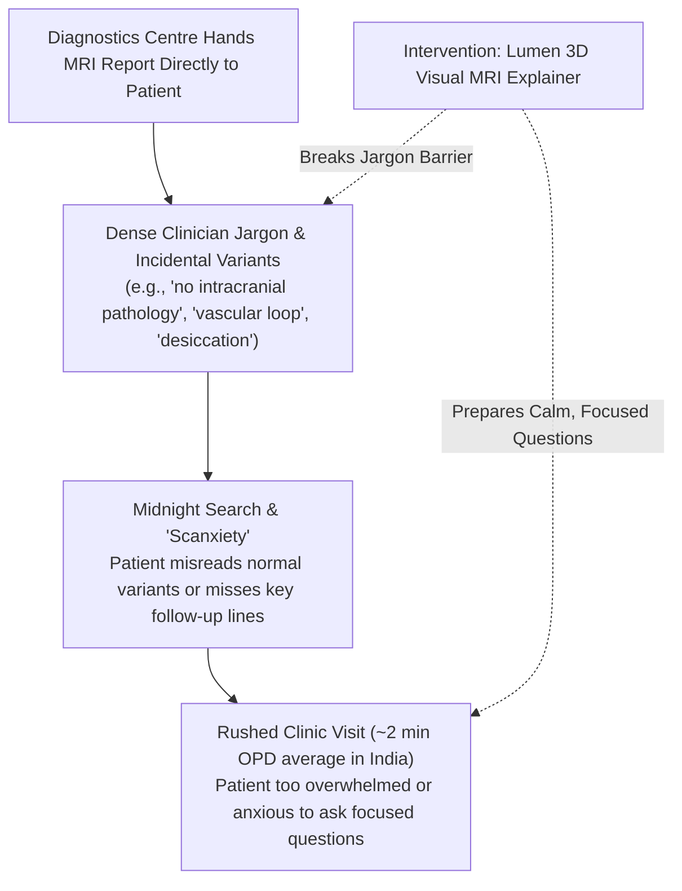
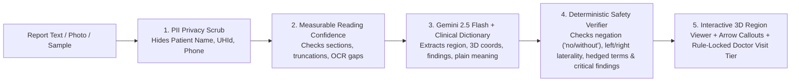

# Research Specification — Lumen: Calm, Visual MRI Report Explainer
**Project:** Studio 5b Internship Assignment — Dr. Reddy’s Laboratories | MIT Institute of Design, Pune (AI-Enabled Design)  
**One Health Topic:** Understanding Your Own MRI Report (Translating Clinician-to-Clinician Radiology Jargon Into Calm, Spatial 3D Understanding)  
**Target Audience:** Non-medical adults (and family caregivers) in India who receive an MRI report directly from a stand-alone diagnostics centre days before their follow-up doctor appointment.

---

## 1. The Lived Problem & Indian Diagnostics Context

In India, patients frequently undergo MRI scans at independent diagnostics centres and receive the printed or PDF/WhatsApp report directly—often days before they can get a slot with their referring specialist. Furthermore, when they do see a physician, primary-care and outpatient consultation windows in India average roughly **2 minutes** (*Irving et al., BMJ Open, 2017*), leaving little time to unpack line-by-line radiological terminology.

Even a reassuring scan uses frightening clinician-to-clinician phrasing:
- **Double-negative clinical jargon:** *"No acute intracranial pathology detected"* or *"unremarkable study"* sounds ominous to a layperson unfamiliar with radiological conventions.
- **Incidental findings & anatomical variants:** Phrases such as *"minor cerebral arterial/vascular loop in the cerebellopontine angle, likely asymptomatic"* or *"L4-L5 disc desiccation"* name critical anatomy (brain vessels, spinal discs) without explaining that such variants are frequently harmless or age-normal—triggering midnight searches and severe **"scanxiety."**

---

## 2. Verified Clinical & HCI Evidence Base

### 2.1 Asymptomatic Prevalence of Scary-Sounding MRI Terms (Brinjikji et al., *AJNR* 2015)
A landmark systematic review and meta-analysis of 3,110 pain-free, **asymptomatic** individuals (*Brinjikji et al., American Journal of Neuroradiology, 2015*) demonstrated that many alarming spinal MRI terms are routine features of normal aging rather than disease:

| MRI Finding in Pain-Free People | Age 20 | Age 30 | Age 40 | Age 50 | Age 60 | Age 80 |
| :--- | :---: | :---: | :---: | :---: | :---: | :---: |
| **Disc Degeneration** | 37% | 52% | 68% | 80% | 88% | 96% |
| **Disc Bulge** | 30% | 40% | 50% | 60% | 69% | 84% |
| **Disc Signal Loss (*Desiccation*)** | 17% | 33% | 54% | 73% | 86% | 97% |
| **Disc Protrusion** | 29% | 31% | 33% | 36% | 38% | 43% |
| **Annular Fissure** | 19% | 20% | 22% | 23% | 25% | 29% |

**Design Implication:** When an MRI report mentions age-related findings (such as disc desiccation or a mild bulge), showing where evidence exists on how common the finding is in symptom-free peers—while explicitly refusing to invent prevalence numbers when clinical data is absent—reduces panic without dismissing the doctor's role.

### 2.2 Patient-Portal "Scanxiety" & Incidentalomas
- **The Context Vacuum:** Healthcare informatics studies on direct release of imaging reports show that reading uncontextualized radiology jargon before speaking with a clinician frequently triggers anxiety, insomnia, and misinterpretation of benign incidental findings (*incidentalomas*).
- **Visual & Sentence-Linked Lay Summaries:** Studies evaluating embedded plain-language glossaries and sentence-linked lay summaries show significant improvements in patient comprehension without increasing psychological distress—provided the tool preserves clinical nuance and clearly separates normal variants from findings that require follow-up.

### 2.3 LLM Radiology Simplification Risks (Why Deterministic Guardrails Are Mandatory)
Clinical evaluations published in *Radiology* and informatics journals (2023–2024) testing LLMs (such as GPT-4 and open-weight models) on radiology report simplification found:
- **High readability gains**, dropping college-level radiological prose to an accessible reading level.
- **A ~5% to 10% error rate**, including a small but critical subset of clinically significant errors:
  1. **Flipped negations:** Turning *"no evidence of acute hemorrhage"* into a false positive or ambiguous warning.
  2. **Flipped laterality:** Swapping *left* and *right* anatomical sides.
  3. **Distorted severity or smoothed-over hedging:** Turning a radiologist's hedged phrase (*"cannot be excluded"*, *"correlate clinically"*) into false certainty.

---

## 3. Systemic Loop & Information Flow

### Hybrid Neuro-Symbolic Pipeline (`/api/explain`)

---

## 4. How Lumen Satisfies All 3 Brief Criteria

1. **Why AI (vs. Static Website/Infographic):** Every MRI report is free-text prose combining anatomical locations, signal intensities, negations, and incidental observations across any body region (brain, spine, knee, shoulder, abdomen). A static glossary cannot parse a patient's specific sentence, map each line onto an interactive 3D model of that region with directional arrows, and link every plain explanation back to the exact original line.
2. **Real-Time Adaptation:**
   - **Region-Adaptive 3D Model:** Automatically loads and rotates a stylized 3D anatomical model matching the detected scan region (`Brain & Cerebral Vessels`, `Lumbar/Cervical Spine`, `Knee Joint`, `Shoulder`, `Abdomen/Pelvis`), placing interactive 3D arrow markers at each finding's anatomical coordinates.
   - **Explanation Depth Toggle:** Switches between **`Calm Summary`** (what it means in everyday words) and **`Deeper Anatomy & Why It Happens`** (how the tissue works + verified prevalence context).
   - **Gentle, Skippable Context Chips:** Asks at most 2 optional, non-alarming context questions (*"What prompted this scan?"*, *"What age range is this scan for?"*) to tailor context without triggering hypochondria.
3. **Safeguards, Uncertainty, Incorrect AI Responses & Sensitive Info:**
   - **Measurable Reading Confidence Score:** Computed deterministically from text completeness, detected report sections (`Technique`, `Findings`, `Impression`), and unreadable/cut-off markers—never a self-invented LLM number. Explicitly states what could not be read.
   - **Negation & Laterality Guard + Side-by-Side Original Line:** Every finding card displays the **exact original report sentence** alongside the plain translation, with an automated check verifying that *"no / without / unremarkable"* and *"left / right"* were preserved.
   - **Rule-Locked Doctor Visit Tiers:** Deterministic clinical keyword scanner locks the visit tier (`Routine Next Visit` | `Discuss at Upcoming Appointment` | `Contact Doctor Promptly Today` | `Emergency Care Now — 108/112`) so the AI can never downplay a critical finding (such as midline shift, cord compression, or acute bleed).
   - **Honest Epistemic Boundaries:** Clearly states *"Not enough medical information in this report alone"* when clinical exam correlation is required, and refuses to diagnose, stage, or prescribe treatment.
   - **Session-Only Privacy:** Automatic client/server redaction of patient names, phone numbers, and hospital IDs, with zero database storage.

---

## 5. Verified References
1. **Brinjikji W, Luetmer PH, Comstock B, et al.** *Systematic Literature Review of Imaging Features of Spinal Degeneration in Asymptomatic Populations.* **Am J Neuroradiol (AJNR).** 2015;36(4):811–816.
2. **Irving G, Neves AL, Dambha-Miller H, et al.** *International variations in primary care physician consultation time: a systematic review of 67 countries.* **BMJ Open.** 2017;7(10):e017902.
3. **Jeblick K, Schachtner B, Dexl J, et al.** *ChatGPT makes medicine easy to swallow: an exploratory case study on simplified radiology reports.* **Eur Radiol.** 2024;34(5):2817–2825. (Evaluates readability gains alongside factual/omission/hallucination risks requiring clinician-in-the-loop and deterministic verification.)

---

## 6. Datasets for Training & Evaluation + Guardrail Frameworks

### 6.1 Open Clinical Datasets for Training & Benchmarking
To move from a prompt-engineered + rule-verified prototype to a fine-tuned/benchmarked clinical NLP pipeline, four established radiology datasets directly support Lumen:
1. **RadGraph & RadGraph-XL (PhysioNet / Stanford):** Expert-annotated clinical entities (*Anatomy*, *Observation: Definitely Present*, *Observation: Definitely Absent*, *Observation: Uncertain*) and relations across multi-modality radiology reports including **Brain MRI** and **Abdomen/Pelvis CT**. Ideal for training and benchmarking Lumen's **Negation, Laterality, and Uncertainty Verifier**.
2. **MIMIC-IV-Note (`RR` Radiology Table — MIT / Beth Israel Deaconess):** De-identified free-text radiology reports (Findings + Impressions) across MRI, CT, and X-ray, enabling large-scale evaluation of reading-confidence scoring and section completeness.
3. **fastMRI (NYU Langone / Meta AI):** Large-scale open dataset of raw and reconstructed **Brain and Knee MRI** scans paired with clinical annotations—directly matching Lumen's hero regions (Brain & Knee).
4. **OASIS-3 (Open Access Series of Imaging Studies):** Longitudinal neuroimaging and clinical brain MRI dataset for benchmarking age-normal brain volume and incidental variant reporting.

### 6.2 Formal Clinical Guardrail Frameworks
1. **AHRQ PEMAT (Patient Education Materials Assessment Tool):** Federal healthcare standard evaluating patient materials on two axes: **Understandability** (plain language, visual aids, zero unexplained jargon, chunked layout) and **Actionability** (explicit next-step visit tier and concrete questions to ask the clinician).
2. **RadGraph Entity-Relation Fidelity Check:** Ensures every anatomical site and negation/uncertainty modifier in the original report (`"No evidence of nerve thinning / buckling"`, `"Right AICA loop — Type II Chavda"`) maps 1-to-1 into the lay translation without polarity flips.
3. **ACR (American College of Radiology) / RadiologyInfo Patient Summary Standards:**Separates *technical sequence description* (`T1W Sagittal`, `T2W Axial`, `FLAIR Coronal`, `DWI`) from *anatomical observations* and *actionable clinical impression*.
4. **ChronoLink (UX Studio IV — Praneetha Kamabathula) Psychological Safety Bridge:**
   - Verified directly from `UX Studio IV PPT.pdf` (Slides 10, 12, 14, 16, 21–23, 33–36):
     - **Slide 12:** Individual behavior, social circumstances, and environment drive **67%** of healthcare outcomes.
     - **Slide 10:** **53–84%** of informal caregivers are female; **40%** meet clinical criteria for anxiety/depression.
     - **Slide 22 (David Rock's SCARF Model):** Chronic/serious health events threaten *Status, Certainty, Autonomy, Relatedness,* and *Fairness*. Lumen restores **Certainty** (measurable reading confidence + 3D spatial orientation) and **Autonomy** (optional skippable prompts + non-judgmental doctor questions).
     - **Slides 33–36 (Gradual, Calm Escalation):** Passive/reassuring by default during normal or variant findings, escalating calmly and decisively only when a rule-locked clinical threshold is crossed.
